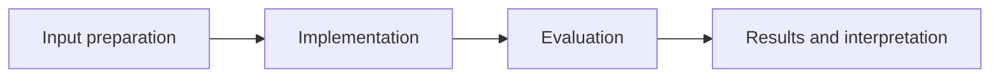

# Handwritten Digit CNN Comparison

**Feras Elghandour** · Technical case study

Compare a shallow convolutional baseline with a deeper regularized classifier on low-resolution handwritten digits.

## Implementation

Stratified training/validation/test splits, normalization, shallow versus BatchNorm/Dropout CNNs, training curves, confusion matrices, and per-class evaluation.



## Evidence and results

The saved experiment reports baseline accuracy 97.78% and deep-model accuracy 98.89% on 360 test images; macro-F1 values are 0.9777 and 0.9888 respectively. The release separately records any fresh reproduction run.

Results described as saved come from the retained experiment record. See [VALIDATION.md](VALIDATION.md) for the checks performed on this release and their scope.

## Fresh reproduction — October 17, 2026

Fresh CPU execution reports baseline test accuracy 97.78% and deeper-model accuracy 99.17%, with macro-F1 0.9777 and 0.9915 on the same 360-row test partition. These fresh results are separate from the saved run above.

The environment versions, input hashes, and notebook hash are recorded in [results/reproduction.json](results/reproduction.json).


## Practical relevance

This project demonstrates stratified training/validation/test splits, normalization, shallow versus BatchNorm/Dropout CNNs, training curves, confusion matrices, and per-class evaluation.
The implementation and evaluation make the trade-offs inspectable for technical review.

## Run locally

```sh
python -m venv .venv
source .venv/bin/activate
python -m pip install -r requirements.txt
jupyter lab analysis.ipynb
```

Prepare the inputs described in [DATA.md](DATA.md) first. Source validation is available without installing model dependencies:

```sh
python scripts/validate_source.py
```

## Limitations

This is one small, single-seed 8×8-image benchmark. A more complex architecture improving this test score does not establish superiority on other datasets or larger images.

## Development

Changes should include a clear description of the behavior affected and verification appropriate to that behavior. Keep input data, credentials, model caches, and generated artifacts outside version control.
