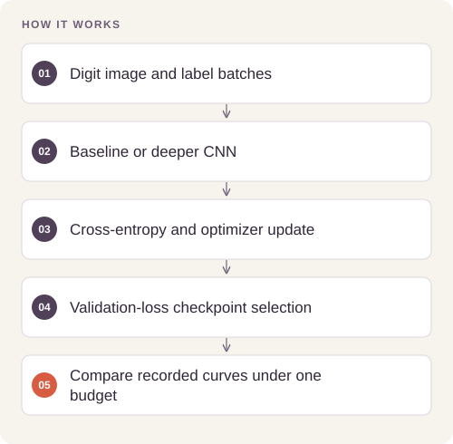
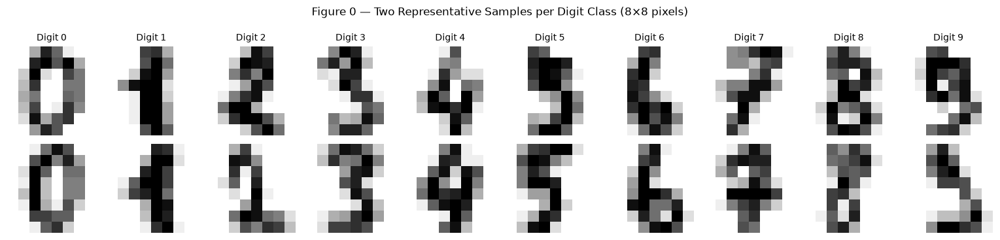

# Handwritten Digit CNN Comparison

Compare a shallow convolutional baseline with a deeper regularized classifier on low-resolution handwritten digits.

## Implementation

Stratified training/validation/test splits, normalization, shallow versus BatchNorm/Dropout CNNs, training curves, confusion matrices, and per-class evaluation.



## Try a small example

A 32-image fixture runs one training epoch through the notebook definitions. The same tiny batch is used for training and validation to exercise the interface; its accuracy is not an evaluation result.

After the local setup below, run from the repository root:

```sh
python examples/quickstart.py
```

The [example source](examples/quickstart.py), [captured output](examples/expected-output.txt) and [execution record](examples/environment.json) keep this demonstration inspectable. Floating-point values may vary with library versions.

Observed output from this run:

```text
{
  "fixture": "32 digits, same training/validation samples, demonstration only",
  "logits_shape": [
    2,
    10
  ],
  "history": {
    "train_loss": [
      2.308488368988037
    ],
    "val_loss": [
      2.29546058177948
    ],
    "train_acc": [
      0.09375
    ],
    "val_acc": [
      0.09375
    ]
  }
}
```

## Evidence and results

The saved experiment reports baseline accuracy 97.78% and deep-model accuracy 98.89% on 360 test images; macro-F1 values are 0.9777 and 0.9888 respectively. The release separately records any fresh reproduction run.

See [VALIDATION.md](VALIDATION.md) for the release checks and their scope.

## Fresh reproduction — October 17, 2026

Fresh CPU execution reports baseline test accuracy 97.78% and deeper-model accuracy 99.17%, with macro-F1 0.9777 and 0.9915 on the same 360-row test partition. These fresh results are separate from the saved run above.

The environment versions, input hashes, and notebook hash are recorded in [results/reproduction.json](results/reproduction.json).



## Run locally

```sh
python -m venv .venv
source .venv/bin/activate
python -m pip install -r requirements.txt
jupyter lab analysis.ipynb
```

Prepare the inputs described in [DATA.md](DATA.md) first. Source validation is available without installing model dependencies:

```sh
python scripts/validate_source.py
```

## Limitations

This is one small, single-seed 8×8-image benchmark. A more complex architecture improving this test score does not establish superiority on other datasets or larger images.
